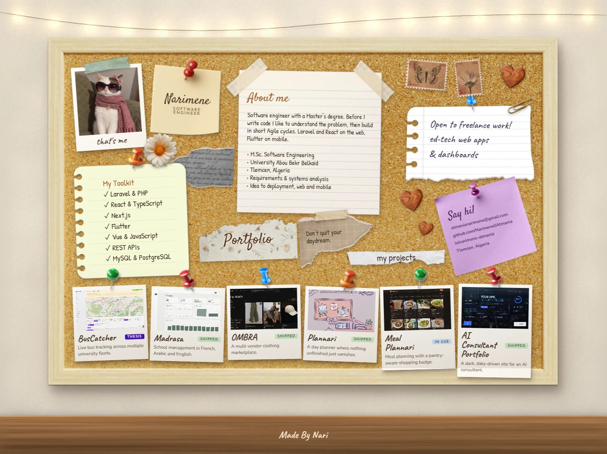

# Corkboard portfolio



Plain static site: `index.html`, `css/styles.css`, `js/main.js`, `assets/`. No build step.

```bash
python -m http.server 5173
```

Then open http://localhost:5173. Deploy the folder as-is to GitHub Pages, Netlify or Vercel.

## Fill in before publishing

- `index.html`, contact card: `[your email]`, `github.com/[username]`, `linkedin.com/in/[username]` and their `href`s
- `js/main.js`, `PROJECTS`: descriptions, stacks, screenshots and links in the project detail view.
  School Manager, Clothes Shop and Agency Site stacks are placeholders.
- `index.html`: project polaroid screenshots for School Manager, Clothes Shop and Agency Site
- `assets/photo-cat.png`: swap for a real portrait if wanted
- `index.html`, footer credits: confirm licences (Vecteezy attribution, `board.jpg` source)

## How it works

- Desktop: the 1600×1160 board is scaled with CSS `zoom` driven by `--scale` (viewport width ÷ 1600), so positions stay exact.
- Cards are positioned with `--x --y --w --r` custom properties (`.card`, `.prop`, `.pin`).
- Under 768px the board is dropped and cards stack in one column on a cork tile (`assets/cork-tile.jpg`, cropped from `board.jpg`).
